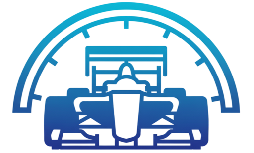

#  FieldKit AI 
### *Data Acquisition and Telemetry System for the ERB 02-EVO Formula SAE Car - 2026*

## 📈 Overview

<p align="center">
  
</p>

> Data shown in the demo is randomly generated by the built-in ECU data simulator (<code>tester_uart</code>), not recorded from the car.

A cross-platform desktop application that receives the telemetry stream sent by the car's **ECU** over a serial link, decodes it and shows it **in real time** across a set of dockable windows: speed, pedals, steering, suspensions, inverters, temperatures and the 14 battery modules.

The same tool is used after the run to **reopen the recordings** (the `.bin` files written by the ECU to its SD card, or the `.csv` logs saved by the app itself), scroll through them over time and export them for analysis.

## 🎯 Features

* **Live mode:** reads the UART stream at **500 000 baud**, decodes **200 packets per second** and updates every window at 10 Hz without blocking the UI.
* **Recording:** one click logs every packet (200 Hz) to a CSV file.
* **Playback mode:** loads `.bin` / `.csv` sessions and replays them with a time slider and synchronized plots.
* **High-res export:** converts the raw `.bin` from the SD card into a full-resolution `.csv`.
* **Live statistics:** rolling mean / variance / standard deviation, session max and mean, distance travelled.
* **Diagnostics:** decoded state machines, AMK inverter error codes shown as readable text, and a built-in log terminal.
* **Backward compatible:** old recordings remain readable after the firmware changes the packet format.

## 🧠 How It Works

The ECU sends two binary packets, each protected by a **CRC-16/CCITT-FALSE** checksum:

| Packet | Rate | Content |
|---|---|---|
| **A** | every 5 ms (200 Hz) | wheel speeds, pedals, steering, inverters, temperatures, state machines |
| **B** | every 200 ms | battery: state of charge, voltage and temperature of the 14 modules |

```
LIVE:  ECU → UART → SerialService → PacketParser → DataAggregator → DataManager → UI + CSV
FILE:  .bin/.csv → FileService → TelemetryDataset → PlaybackManager → UI
```

* Serial acquisition and decoding run on **dedicated threads**, so the interface stays smooth even at full data rate.
* The packet layout is defined in **a single schema** (`TelemetrySchema.cpp`). The live parser, the file loaders, the CSV logger and the export are all generated from it.
* Every past packet layout is kept frozen: when decoding, the parser picks the layout whose length and CRC match, so older SD recordings still load.

## 🚀 Getting Started

**1. Clone and fetch the dependencies**
```bash
git clone https://github.com/DanieleGotti/FormulaSAE_Telemetry_Software.git telemetry
cd telemetry
git submodule update --init external/glfw external/glm external/imgui external/implot
```

**2. Build** (Windows with MSYS2/MinGW shown; Linux and macOS drop the `-G` option)
```bash
cmake -S . -B build_windows -G "MinGW Makefiles" -DCMAKE_BUILD_TYPE=Release
cmake --build build_windows -j 8
```

**3. Run**
```bash
./build_windows/telemetry.exe
```

### 🧪 Try it without the car

Two Python simulators (`pip install pyserial`) let you test the software without the vehicle:

* **From a file:** `python tester_bin_sd/main.py` generates 10 s of random data in a `.bin` file. Open it from the **Load from file** window.
* **Live:** `python tester_uart/main.py` opens an ECU simulator that streams packets on a serial port. Connect two ports with a virtual null-modem (e.g. [com0com](https://sourceforge.net/projects/com0com/) on Windows), press **START SPAM** in the simulator and **Connect** in the app.

> Full instructions (project structure, how to add or change telemetry values, troubleshooting) are in the [Developer Guide](DEVELOPER_GUIDE.md).

## 🛠️ Tech Stack

* **Language:** C++20
* **UI:** [Dear ImGui](https://github.com/ocornut/imgui) (docking branch) + [ImPlot](https://github.com/epezent/implot) on [GLFW](https://github.com/glfw/glfw) / OpenGL
* **Libraries:** [GLM](https://github.com/g-truc/glm), [jsoncons](https://github.com/danielaparker/jsoncons), [stb_image](https://github.com/nothings/stb)
* **Build:** CMake
* **Platforms:** Windows, Linux, macOS
* **Tools:** Python simulators for the serial stream and the SD-card files

## 👨‍💻 Authors

| Name | Team | GitHub |
|------|------|--------|
| Daniele Gotti | E-Racing Bergamo | [@DanieleGotti](https://github.com/DanieleGotti) |
| Samuele Stasi | E-Racing Bergamo | [@s-stasi](https://github.com/s-stasi) |
